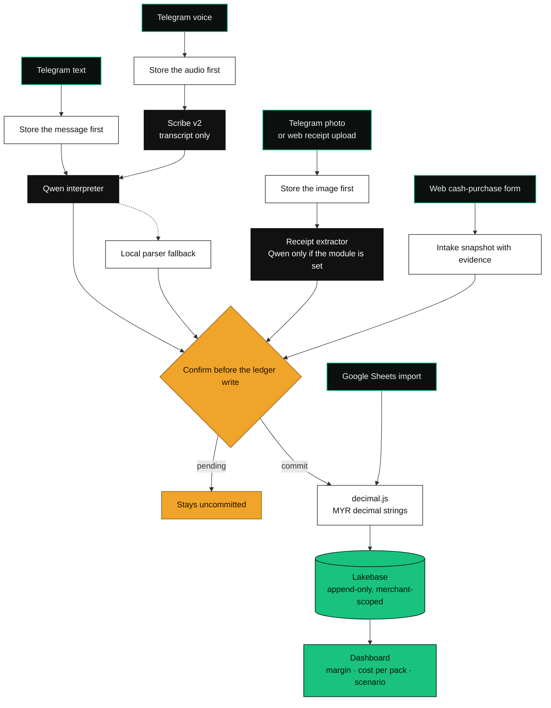
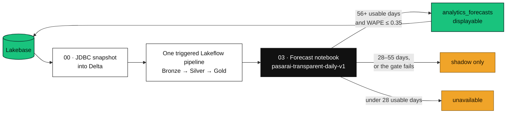
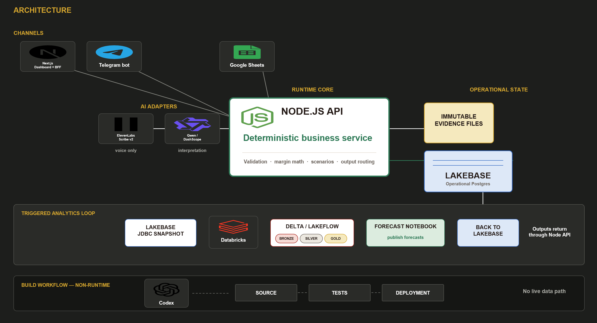
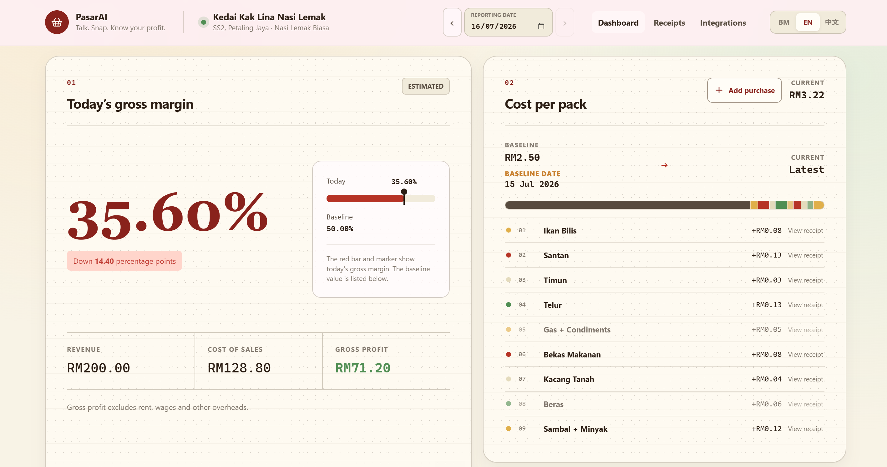
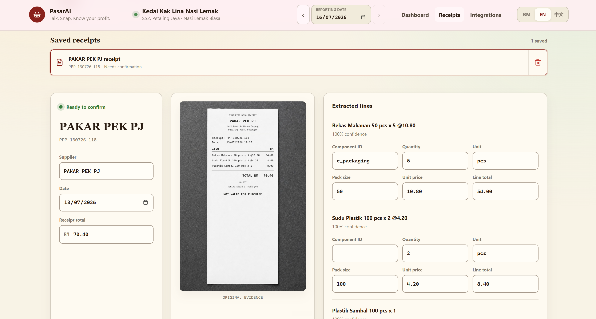
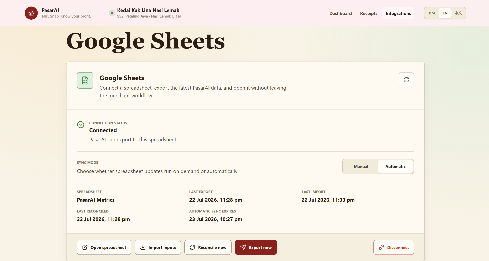

<p align="center">
  <strong>🏆 1st place · KL Codex Community Hackathon</strong>
</p>

<p align="center">
  <strong>Say a sale, or snap a supplier receipt. Get a merchant-confirmed gross margin.</strong><br>
  <sub>English, Bahasa Melayu, Simplified Chinese, and Manglish. Evidence is stored first. The merchant confirms. <code>decimal.js</code> writes MYR. The model never does the arithmetic.</sub>
</p>

<p align="center"><sub>Next.js · React · Node.js · pnpm · Lakebase · Databricks · Telegram · ElevenLabs · Qwen</sub></p>

---

## ▍The problem

Malaysian owner-operated food stalls record sales and supplier changes while they are still serving customers. The update arrives as speech, chat, a paper note, or a receipt photo, in English, Bahasa Melayu, Simplified Chinese, or Manglish. The owner needs today's gross margin and the new cost per pack. They do not need a bookkeeping form.

A model that "just answers" will invent a total. PasarAI keeps the raw evidence, asks when a field is missing, and commits MYR only after the merchant confirms. Every money figure after that comes from decimal-safe code.

## ▍The pipeline at a glance



| Stage | What decides | What it does not decide |
| --- | --- | --- |
| **Capture** | Telegram webhook (`X-Telegram-Bot-Api-Secret-Token`) or the Next.js BFF (signed HttpOnly session). A duplicate Telegram `update_id` returns the original event. | It does not interpret the payload before the evidence file exists. |
| **Voice** | ElevenLabs Scribe v2, optional `ELEVENLABS_SCRIBE_KEYTERMS`. | Transcript text only. Scribe does not commit a sale. |
| **Intent** | Qwen via DashScope. Defaults in code: `qwen3.7-plus`, fallback `qwen-plus`. The endpoint manifest marks six conversation tools: sales, costs, cost changes, corrections, daily summary, and a read-only price simulation. | If the key is absent, the call fails, or the proposal fails grounding, the local deterministic parser answers. ElevenLabs tool retries in the same agent turn reuse the conversation id and turn count. A retry in a later turn can receive a new key. |
| **Receipt** | An injected extractor. The repo ships `qwen-receipt-extractor.js` (default `qwen3.7-plus-2026-05-26`), loaded only when `PASARAI_RECEIPT_EXTRACTOR_MODULE` is set. | A line whose total disagrees by more than RM0.05 is not auto-committed. Pack size is required. The photo stays attached for review. |
| **Cash purchase** | Versioned purchase-intake snapshots. A complete snapshot returns a confirmation token. Confirm, cancel, and update of the same version share one claim. | A partial intake does not touch the cost ledger. |
| **Money** | `@pasarai/finance` with `decimal.js`. Currency rounds to two decimal places only at the output boundary. Scenarios are read-only. | The model does not add, round, or invent wages. Gross profit excludes rent, wages, and other overheads. |
| **Record** | Lakebase through `pg`. Mutations send `Idempotency-Key`. Corrections append a new fact, including a plain-language fix of a recent sale that does not quote an event id. | Sheets is not the system of record. OAuth tokens are encrypted before storage. |
| **Show** | Next.js dashboard and BFF. The bearer stays on the server. Locales are `ms` (default), `en`, and `zh`. | The dashboard source does not embed an ElevenLabs widget. |

The analytics loop is off the request path. A person runs it. The dashboard reads Lakebase through the API.



The three forecast models are `weekday_seasonal_naive`, `robust_same_weekday_median`, and `exponentially_weighted_recent_trend`. Accepted receipt lines are the only ones that become Silver cost facts. Pending receipts stay in Silver for review. Historical sales in the seed notebook never become operational raw events.



`packages/contracts` is the only v1 payload authority: JSON Schema 2020-12, generated runtime validators, and the endpoint manifest. OpenAPI is deferred and is not canonical. Apps, the API, finance, and the data platform import those schemas.

## ▍The demo

Recorded walkthrough: [PasarAI demo video](https://www.loom.com/share/70c7234b4b104fed9018b8f2cce67773).

The synthetic web preview runs with no provider key, no Lakebase, and no live API. It is marked on screen. Production builds reject `PASARAI_SYNTHETIC_PREVIEW=1`. The preview reads `fixtures/demo/current-snapshot.json` (reporting date 16 July 2026, merchant Kedai Kak Lina Nasi Lemak, SS2 Petaling Jaya). That file is a demo snapshot. `expected_metrics.json` in the handoff seed is a different calculation and does not match this still.

<table>
  <tr>
    <td width="50%" valign="top">
      
      <br>
      <strong>01 · MARGIN.</strong> Synthetic day 16 July 2026. The card is badged Estimated. The footer states that gross profit excludes rent, wages, and other overheads.
    </td>
    <td width="50%" valign="top">
      
      <br>
      <strong>02 · RECEIPT.</strong> The photo stays beside the extracted lines until the merchant confirms. This fixture is marked not valid for purchase.
    </td>
  </tr>
  <tr>
    <td width="50%" valign="top">
      
      <br>
      <strong>03 · SHEETS.</strong> Connect, choose manual or automatic sync, then export, import inputs, or reconcile. Lakebase remains the ledger.
    </td>
    <td width="50%" valign="top">
      <strong>04 · SCRIPT.</strong> The 120-second rehearsal is a script, with disclosure lines for a down provider. <code>pnpm demo:rehearse</code> checks that plan. Receipt fallback: review the preserved photo, and do not claim a live model read. Databricks fallback: show the last Gold snapshot as previously processed demo state.
    </td>
  </tr>
</table>

Full timing and recovery lines: [docs/demo-120-second-rehearsal.md](docs/demo-120-second-rehearsal.md).

## ▍Run it

Requirements: Node.js 22, 23, or 24 (`>=22 <25`), pnpm `10.29.3`, and Python 3 for the Databricks unit tests. There is no root Makefile and no Python requirements file. Those tests use the standard library.

```bash
corepack enable
pnpm install --frozen-lockfile
```

### Synthetic preview, no keys

```bash
cp apps/web/.env.example apps/web/.env.local
pnpm --filter @pasarai/web dev
```

Open `http://localhost:3000`. `apps/web/.env.example` sets `PASARAI_SYNTHETIC_PREVIEW=1`. The preview is labeled, and a production build rejects that flag.

On PowerShell, copy the env file with `Copy-Item apps/web/.env.example apps/web/.env.local`.

### Full stack

The API fails closed until merchant, database, and bearer configuration are present.

1. Copy `.env.example` to `services/api/.env`.
2. Copy `apps/web/.env.example` to `apps/web/.env.local`.
3. Set at least `PASARAI_MERCHANT_ID`, `LAKEBASE_DATABASE_URL`, and `PASARAI_API_BEARER_TOKEN` for the API.
4. Set the matching `PASARAI_API_BASE_URL`, bearer, merchant, and product values for the web app.
5. Start both:

```bash
pnpm dev
```

| URL | What |
| --- | --- |
| `http://localhost:3000` | Dashboard. Default reporting date is `2026-07-16` unless `PASARAI_DASHBOARD_DATE` is set. |
| `/receipts` | Receipt review. |
| `/settings/integrations` | Google Sheets connect, sync mode, export, import, reconcile. |
| `/login` | Shown when web auth is on. `PASARAI_WEB_AUTH_REQUIRED=0` is only for a trusted demo that should open without a login screen. Auth is required when the variable is omitted. |
| `http://localhost:3001` | API, unless `PORT` is set. `/api/v1/*` is merchant-bound bearer auth. `/webhooks/telegram` uses Telegram's secret-token header. `/webhooks/google-drive` uses `X-Goog-Channel-Token`. |

Browser mutations go through same-origin Next.js routes. The API bearer is never a `NEXT_PUBLIC_*` value. The BFF replaces request merchant context with the configured deployment merchant and rejects cross-origin mutations.

**No provider key is required for the synthetic dashboard.** Keys matter only for live integrations. Keep real values in ignored env files. The committed examples contain names and placeholders only.

| Group | Names |
| --- | --- |
| API, required for a live process | `PASARAI_MERCHANT_ID`, `LAKEBASE_DATABASE_URL`, `PASARAI_API_BEARER_TOKEN` |
| Web, required for a live dashboard | `PASARAI_API_BASE_URL`, `PASARAI_API_BEARER_TOKEN`, `PASARAI_MERCHANT_ID`, `PASARAI_MERCHANT_NAME`, `PASARAI_MERCHANT_LOCATION`, `PASARAI_PRODUCT_ID`, `PASARAI_PRODUCT_NAME` |
| Web session | `PASARAI_WEB_AUTH_REQUIRED`, `PASARAI_WEB_SESSION_SECRET` (at least 32 characters), `PASARAI_WEB_ACCESS_CODE` |
| Preview | `PASARAI_SYNTHETIC_PREVIEW`, `PASARAI_DASHBOARD_DATE` |
| Telegram | `TELEGRAM_BOT_TOKEN`, `TELEGRAM_WEBHOOK_SECRET`, `TELEGRAM_ALLOWED_CHAT_ID`, `PASARAI_TELEGRAM_PROCESSING_LEASE_MS`, `PASARAI_TELEGRAM_TIMEOUT_MS` |
| Voice | `ELEVENLABS_API_KEY`, `ELEVENLABS_AGENT_ID`, `ELEVENLABS_SCRIBE_KEYTERMS`, `NEXT_PUBLIC_ELEVENLABS_AGENT_ID` |
| Qwen / DashScope | `DASHSCOPE_API_KEY`, `DASHSCOPE_BASE_URL`, `DASHSCOPE_ORCHESTRATOR_MODEL`, `DASHSCOPE_ORCHESTRATOR_FALLBACK_MODEL`, `DASHSCOPE_RECEIPT_MODEL`, `DASHSCOPE_VISION_FALLBACK_MODEL`, `PASARAI_MESSAGE_INTERPRETER_MODULE`, `PASARAI_RECEIPT_EXTRACTOR_MODULE`, `PASARAI_LLM_MAX_TOKENS`, `PASARAI_LLM_TIMEOUT_MS` |
| Catalogs | `PASARAI_PRODUCT_CATALOG_JSON`, `PASARAI_COMPONENT_CATALOG_JSON` |
| Evidence | `PASARAI_EVIDENCE_ROOT`, `PASARAI_PUBLIC_EVIDENCE_BASE_URL` |
| Google Sheets | `GOOGLE_CLIENT_ID`, `GOOGLE_CLIENT_SECRET`, `GOOGLE_TOKEN_ENCRYPTION_KEY`, `GOOGLE_SHEETS_WEBHOOK_URL`, `GOOGLE_API_TIMEOUT_MS`, `GOOGLE_SHEETS_SYNC_INTERVAL_MS`, `GOOGLE_SHEETS_SYNC_LEASE_MS`, `GOOGLE_SHEETS_WORKER_STAGE_TIMEOUT_MS` |
| Databricks | `DATABRICKS_HOST`, `DATABRICKS_TOKEN_OR_OAUTH_CONFIG`, `DATABRICKS_WORKSPACE_ID`, `DATABRICKS_CATALOG`, `DATABRICKS_SCHEMA`, `DATABRICKS_RECEIPT_MODEL_ID`, `DATABRICKS_RECEIPT_ENDPOINT`, `LAKEBASE_SSL`, `LAKEBASE_SSL_REJECT_UNAUTHORIZED` |
| Host | `PORT`, `RAILWAY_PUBLIC_URL` |

The Qwen message adapter still runs on the local parser when `DASHSCOPE_API_KEY` is missing or the provider call fails. Point `PASARAI_MESSAGE_INTERPRETER_MODULE` at `services/api/src/providers/qwen-message-interpreter.js` to load it. The receipt extractor is loaded only from `PASARAI_RECEIPT_EXTRACTOR_MODULE`. The runtime does not invent a model or endpoint.

Lakebase migrations and the synthetic database seed, once a database URL is configured:

```bash
pnpm --filter @pasarai/api db:migrate
pnpm --filter @pasarai/api db:seed:synthetic
pnpm --filter @pasarai/api start
```

`pnpm seed:synthetic:reset` rewrites only `fixtures/synthetic` and does not use the network. `pnpm demo:reset` restores local fixtures and writes Lakebase only when live configuration is present. `pnpm demo:rehearse` checks the 120-second plan.

ElevenLabs agent commands. `apply` patches the agent in `ELEVENLABS_AGENT_ID`. It does not create an agent. `test:remote` needs the public API, tool auth, and voices already configured.

```bash
pnpm --filter @pasarai/elevenlabs-agent test
pnpm --filter @pasarai/elevenlabs-agent validate
pnpm --filter @pasarai/elevenlabs-agent apply
pnpm --filter @pasarai/elevenlabs-agent test:remote
```

Databricks itself is a manual workspace setup: one Lakebase project, one triggered serverless pipeline, secret-scoped JDBC, then notebooks `00`, `02`, and `03`. Steps and the teardown warning are in [databricks/README.md](databricks/README.md). Google Cloud OAuth steps are in [docs/google-sheets-integration.md](docs/google-sheets-integration.md). The human checklist is [docs/manual-actions.md](docs/manual-actions.md).

### Tests

```bash
pnpm contracts:check
pnpm lint
pnpm typecheck
pnpm typecheck:web
pnpm test
pnpm build:web
pnpm test:web:browser
pnpm ci:check
```

`pnpm test` runs scaffold, unit, contract, and integration suites: contracts, finance, analytics, the API, the ElevenLabs package, Databricks (`python -m unittest discover -s databricks/tests -p "test_*.py"`), and the Vitest web suite. `pnpm ci:check` is what `.github/workflows/ci.yml` runs on push and pull request, on Node 24, after `pnpm install --frozen-lockfile`.

## ▍Repository map

```
PasarAI/
├── apps/web/                 Next.js dashboard, receipt review, purchases, Sheets settings
├── services/api/             HTTP API, Telegram ingestion, evidence files, Sheets worker
├── packages/contracts/       JSON Schema 2020-12, generated validators, endpoint manifest
├── packages/finance/         decimal.js money and margin
├── packages/analytics/       demand forecast and price-volume scenarios
├── packages/elevenlabs-agent/  Live Advisor config, tools, prompts, conversation tests
├── databricks/
│   ├── lakebase/             migrations 001–009 and the Python repository
│   ├── notebooks/            snapshot, synthetic seed, Gold query, forecast publish
│   ├── pipeline/             the single Lakeflow pipeline
│   └── platform/             local forecast and snapshot equivalents used by tests
├── fixtures/                 contract examples, synthetic seed, demo snapshot, QA plan
├── PasarAI_Handoff_Package/  authoritative synthetic source the seed reset checks
├── docs/                     integration plan, ADRs, rehearsal, Sheets, QA
├── scripts/                  env check, seed, quality, security, Telegram QA
├── tests/                    scaffold, contract, integration, security, docs
├── outputs/                  architecture slide assets
├── skills/                   local agent skill packs, not on the product runtime
├── PRODUCT.md                users, purpose, principles
└── DESIGN.md                 visual and interaction rules
```

| Doc | |
| --- | --- |
| [PRODUCT.md](PRODUCT.md) | Who it is for, and the rule that uncertain input stays visible |
| [DESIGN.md](DESIGN.md) | Design system and interaction rules |
| [docs/integration-plan.md](docs/integration-plan.md) | Ownership boundaries and contract rules |
| [docs/contract-change-process.md](docs/contract-change-process.md) | How a v1 schema change lands |
| [docs/adr/0001-json-schema-contract-authority.md](docs/adr/0001-json-schema-contract-authority.md) | Why JSON Schema is canonical |
| [docs/google-sheets-integration.md](docs/google-sheets-integration.md) | OAuth, webhook, and sync |
| [docs/demo-120-second-rehearsal.md](docs/demo-120-second-rehearsal.md) | Timed script and disclosure lines |
| [docs/qa-demo-release-checklist.md](docs/qa-demo-release-checklist.md) | Release checklist |
| [docs/manual-actions.md](docs/manual-actions.md) | Steps a person still has to do |
| [apps/web/README.md](apps/web/README.md) | Web env and auth |
| [services/api/README.md](services/api/README.md) | Ingestion, intake, and production composition |
| [databricks/README.md](databricks/README.md) | Quota-aware Lakehouse setup |
| [packages/contracts/README.md](packages/contracts/README.md) | Contract package |
| [packages/elevenlabs-agent/README.md](packages/elevenlabs-agent/README.md) | Agent apply checklist |
| [fixtures/README.md](fixtures/README.md) | What the synthetic reset is allowed to touch |

## ▍What this is, and isn't

We'd rather be precise than impressive.

- Kedai Kak Lina Nasi Lemak is a synthetic merchant (`m_kak_lina_001`, Asia/Kuala_Lumpur, MYR). `pnpm seed:synthetic:reset` stays under `fixtures/synthetic` and does not call a network. Synthetic output is not a live stall's books.
- The dashboard still is the 16 July 2026 demo snapshot, badged Estimated. `expected_metrics.json` is a separate handoff calculation. Use the file you are looking at.
- Models propose a tool call or a receipt JSON. `@pasarai/finance` computes the money. Missing fields, low confidence, and a receipt total off by more than RM0.05 stay uncommitted.
- Scribe and Qwen adapters are implemented here. This repository does not record a verified production credential, quota, or live provider response for them.
- `packages/elevenlabs-agent` configures an external agent named in its README as PasarAI Live Advisor. The dashboard package does not render that widget. Voice on the API path is Telegram voice notes through Scribe.
- Databricks is manually triggered. It does not answer dashboard requests. Forecasts under 28 usable days are unavailable. Series with 28–55 usable days, or a failed WAPE gate of 0.35, stay shadow-only. A series is displayable at 56 or more usable days and a passing gate.
- Google Sheets exports metrics and can import controlled edits. Lakebase holds the ledger. Sale edits from Sheets append corrections.
- Gross profit excludes rent, wages, and other overheads. A question about net profit without wages does not get an invented number.
- Corrections append. They do not rewrite the source event.
- Evidence files need a durable mount at `PASARAI_EVIDENCE_ROOT` in production. The repo does not claim object storage, autoscaling, multi-region deployment, or centralized tracing.
- Receipt photos under `apps/web/public/evidence/` and the handoff package are demo evidence.

## ▍Credits

| | |
| --- | --- |
| Dashboard | Next.js 16.2.10, React 19.2.7 |
| API runtime | Node.js, `pg` against Lakebase |
| Money | `decimal.js` 10.6.0 in `@pasarai/finance` |
| Contracts | JSON Schema 2020-12, Ajv 8.20.0 |
| Voice transcript | ElevenLabs Scribe v2 |
| Intent and receipt JSON | Qwen via DashScope. Defaults in code: `qwen3.7-plus`, fallback `qwen-plus`, receipt `qwen3.7-plus-2026-05-26` |
| Ledger | Lakebase (Postgres), migrations in `databricks/lakebase/migrations` |
| Warehouse loop | Databricks Delta and one triggered Lakeflow pipeline |
| Sheets | Google Sheets API and Google Drive notifications |
| Chat | Telegram Bot API |
| Demo merchant | Synthetic fixture, Kedai Kak Lina Nasi Lemak, SS2 Petaling Jaya |
| Build assistance | Codex. The architecture diagram places it on a non-runtime row. |

No product licence file is committed in this repository. `skills/` carries its own notices and is not part of the runtime.

<p align="center">
  <sub>Overall Champion, Codex Community Hackathon KL 2026. Codex assisted the build and is not on the request path.</sub>
</p>
